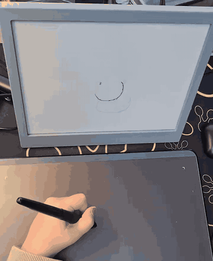
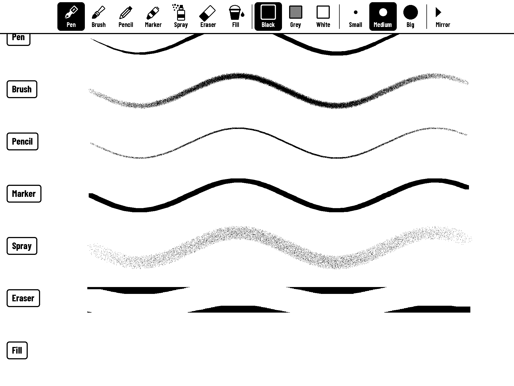
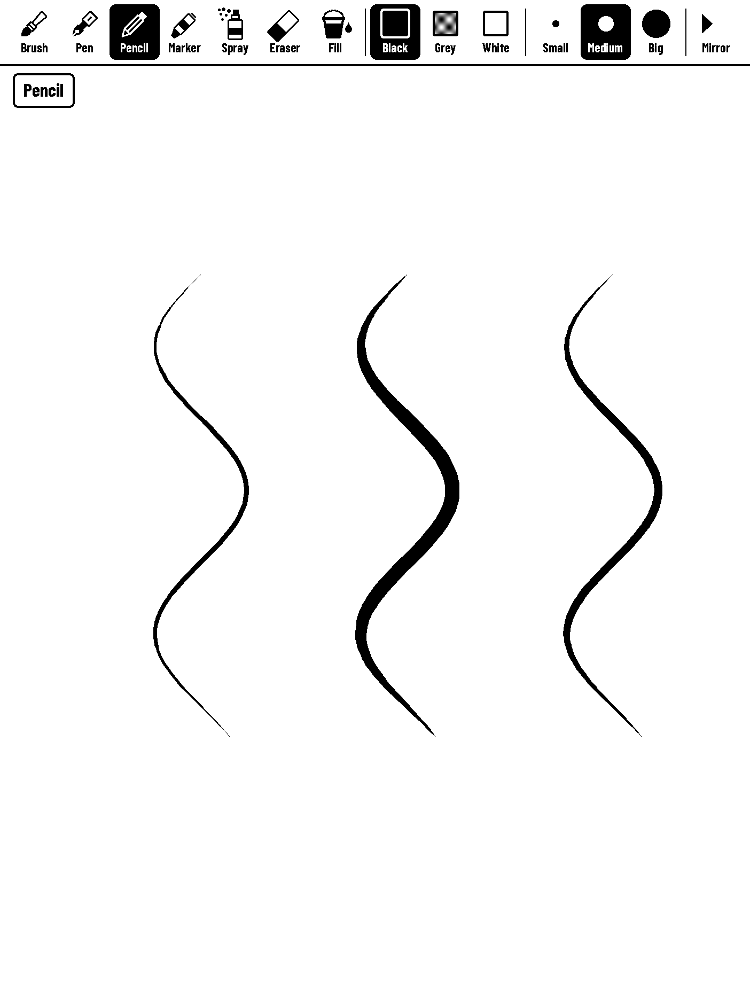
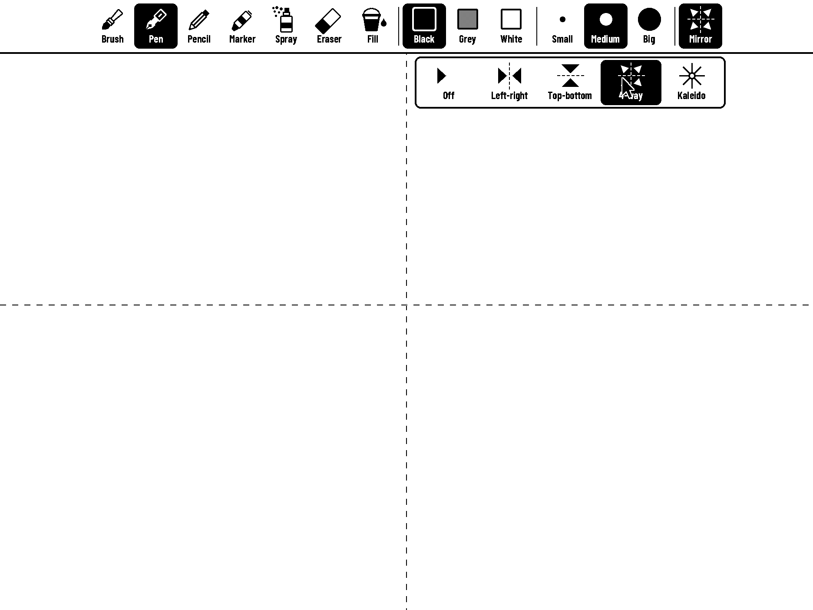
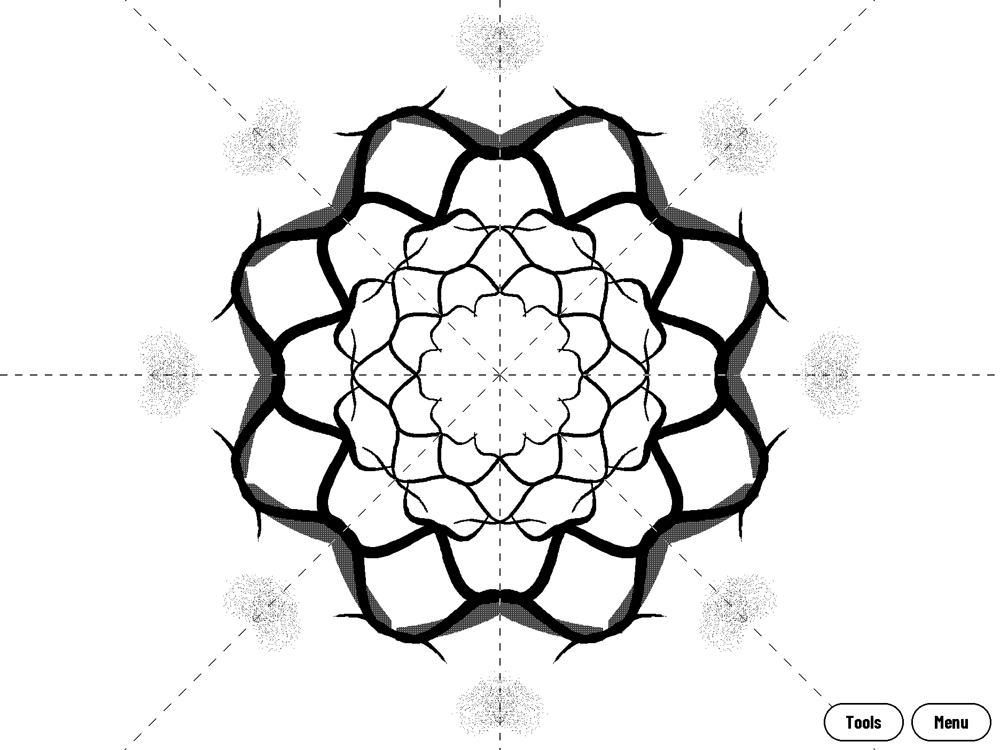
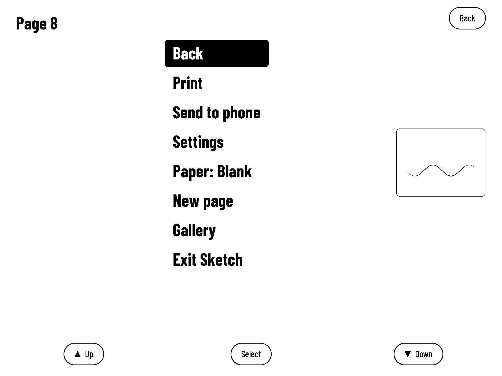
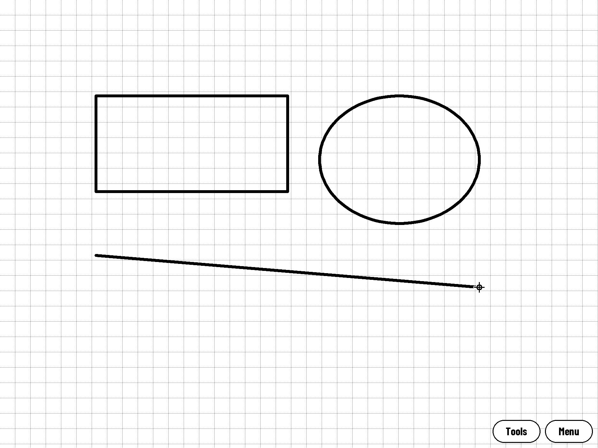
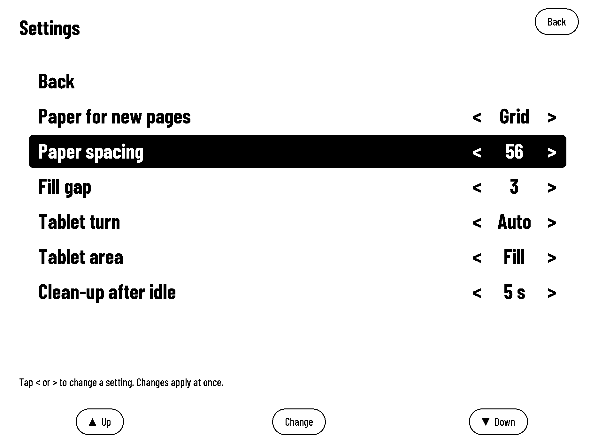
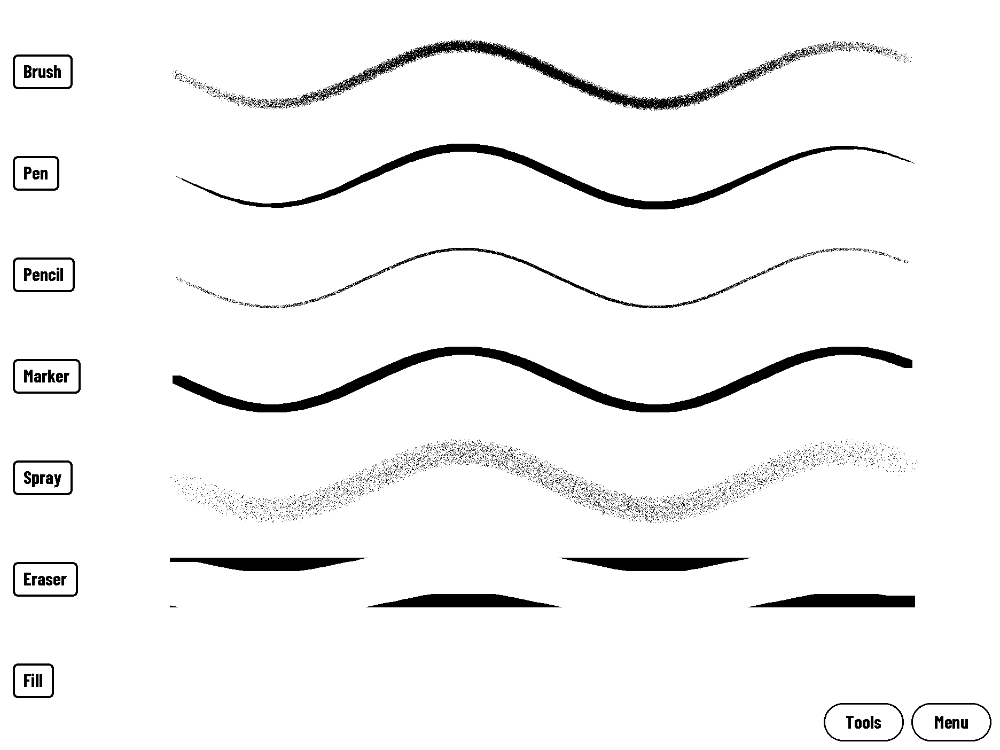
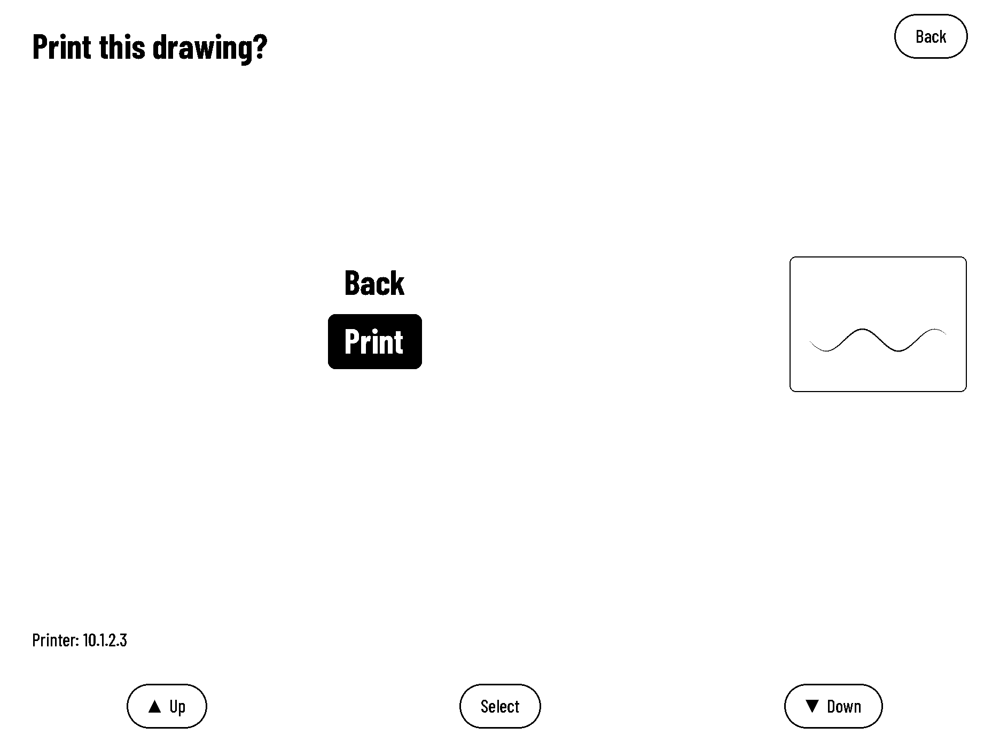

# Sketch for TRMNL X

Draw on the TRMNL X with a USB pen tablet. Pressure sets the line, the page autosaves.

Drawing a cat on the tablet, live on the X (twice as fast here; [the full video](media/sketch-demo.mp4)).

## Features

- Pressure-sensitive brushes: Brush, Pen, Pencil, Marker, Spray, Eraser and Fill
- Black, Grey and White ink, three sizes
- Mirror modes: left-right, top-bottom, 4-way and kaleidoscope
- Paper styles: blank, grid, lines, dots
- Gallery of all pages, undo and redo
- Print to a network printer
- Download pages from a phone
- Pages save themselves while you draw

## Screenshots

| | |
|---|---|
|  The toolbar along the top edge (landscape) |  The same toolbar in portrait |
|  The mirror picker: pick how your strokes are repeated |  A kaleidoscope drawing |
|  The page menu |  Paper styles: grid (also lines, dots, blank) |
|  Settings: tap < or > on a row | |
|  The brushes: pen, brush, pencil, marker, spray, eraser |  Print confirm screen |

## Requirements

- TRMNL X
- XP-Pen Deco 01 V2 tablet (USB)
- The apps firmware: [ExcuseMi/trmnl-firmware, branch `trmnl-apps`](https://github.com/ExcuseMi/trmnl-firmware/tree/trmnl-apps) (USB host for the tablet, app loader, `pen_enable`)
- Optional, for printing: the [Print app](https://github.com/ExcuseMi/trmnl-print). Without it everything else works and Print in the page menu says "No printer yet".

## Install

1. Build the firmware with PlatformIO: `pio run -e TRMNL_X`, and flash the app partition.
2. Upload `trmnl-sketch.elf` (and `trmnl-print.elf` for printing) to the X over the USB cable.

## Controls

| Input | Does |
|---|---|
| Pen | Draws with the picked brush; harder pressure gives a thicker or darker line. Pen button held: eraser |
| Tablet button 1 / 2 | Undo / redo |
| Tablet button 3 | Eraser on or off |
| Tablet button 4 | Show or hide the toolbar |
| Tablet button 5 | Clear the page (one undo brings it back) |
| Tablet button 6 | Brush size: small, medium, big, again (becomes zoom later) |
| Tablet button 7 | Page menu (7 again closes it): print, send to phone, settings, paper, new page, gallery, exit. New page is only here and on the gallery's first tile. Settings (paper, fill gap, tablet, clean-up) are on Sketch's own screen |
| Tablet button 8 | Next colour: black, grey, white, again |
| Mouse right click | Show or hide the toolbar (a mouse alone; the tablet pen's button stays the eraser) |
| Toolbar, last entry "Menu" | Page menu |
| Touch bar, middle tap | Page menu |
| Touch bar, long press | Leave the app |

Tap a tool, colour, size or Mirror in the toolbar with the pen to pick it.

## Design notes

How it works, files, limits and clean-up rules: [docs/DESIGN.md](docs/DESIGN.md).

## Building from source

Needs the [trmnl-print](https://github.com/ExcuseMi/trmnl-print) repository checked out next to this one.

- `make test`: host tests (ASan/UBSan)
- `make elf`: build the app for the X
- `make shots`: render the screenshots

## License

MIT, see [LICENSE](LICENSE).
